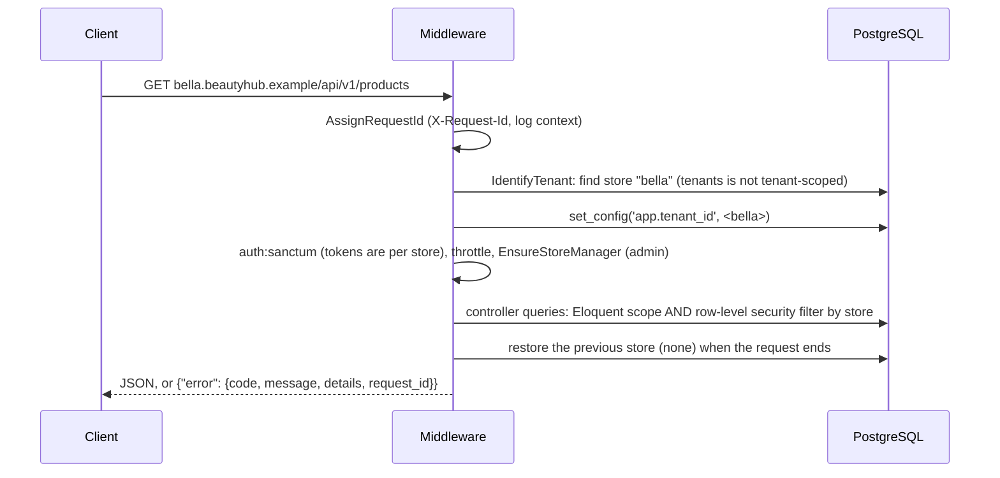
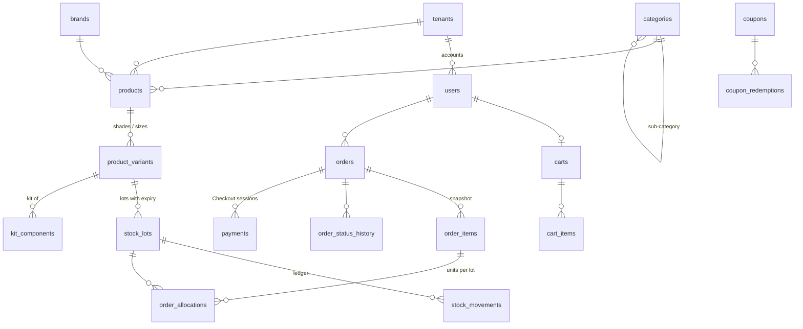
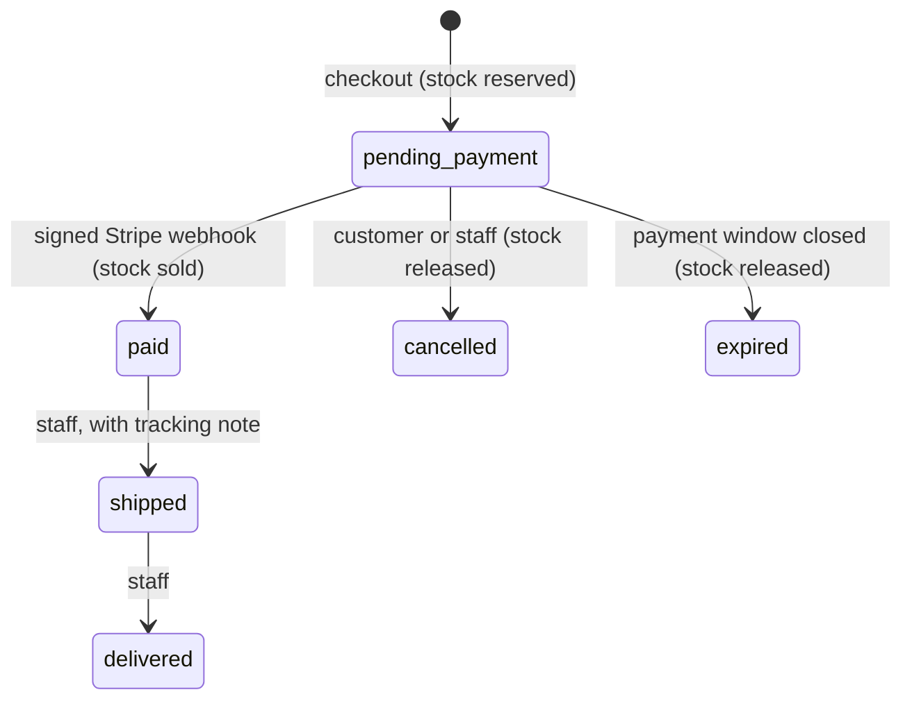
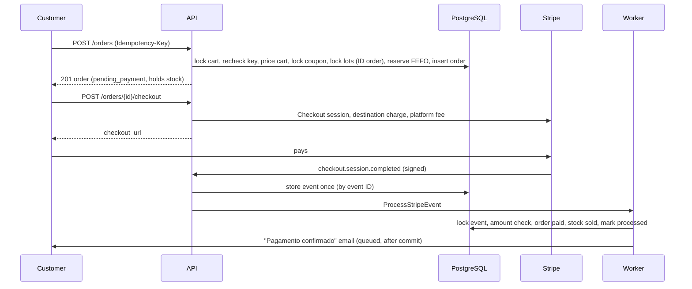

# Architecture

Beauty Hub is a multi-store e-commerce backend for beauty stores: one
Laravel application and one PostgreSQL database serve many stores, each on
its own subdomain. This document covers how requests reach a store, how
stores are kept apart, and how orders, stock and payments stay correct
under concurrency. The decisions behind the main choices are in
[decisions/](decisions).

## Layout

| Directory | What lives there |
| --- | --- |
| `app/Tenancy` | Store context, Eloquent scope, RLS helper, store URLs, per-store loops, job tenancy |
| `app/Catalog` | Typo-tolerant search and filters, per-store cache |
| `app/Inventory` | Lots, ledger, FEFO allocator |
| `app/Cart` | Cart pricing, coupon rules |
| `app/Orders` | Placing orders, the order state machine |
| `app/Payments` | Payment gateway (Stripe Connect), checkout, webhook processing |
| `app/Stores` | Opening a store, team roles |
| `app/Audit` | Audit log of the team's changes |
| `app/Http` | Controllers (thin), form requests, API resources, middleware |
| `app/Console/Commands` | Scheduled work and platform operations |
| `public/storefront` | Demo storefront: build-free JavaScript over the public API |

## Request lifecycle

Middleware order matters and is pinned in `bootstrap/app.php`: the store is
identified before authentication (tokens are stored per store) and rate
limiting (limits are keyed by store); the admin role check runs before
route model binding, so a customer gets 403 on any admin URL instead of
learning from 404s which IDs exist.

## Isolation between stores

Every tenant-scoped table has a `tenant_id` and a forced row-level security
policy comparing it with `app.tenant_id`; the application role cannot bypass
it. Eloquent adds the same filter (`TenantScope`), which keeps intent
visible and lets the planner use the indexes, but correctness does not
depend on it. Details and the sharp edges (foreign keys, views, framework
code, queued jobs) are in [ADR 001](decisions/001-multi-tenancy.md).

What the tests prove, among others:

- Raw SQL inside a store sees only that store's rows; with no store, none.
- A row cannot be written into, or moved to, another store.
- A token, a password reset link or an ID from one store is not found at
  another; the same email can register at two stores.
- A product cannot reference another store's brand, even by direct insert.
- A worker that runs a store's job, then a job with no store, does not
  leak the first store into the second (real worker, real Redis).
- Architecture checks: forced policy on every `tenant_id` table,
  `BelongsToTenant` on every such model, `security_invoker` on every view,
  no RLS bypass for the app role.

## Data model

Money is integer centavos. Keys are UUIDv7. Invariants live in the schema
(`CHECK`s, unique and partial indexes, composite foreign keys), with the
application checks on top. Order lines keep a copy of name, SKU and price.

## Order lifecycle

`OrderTransitions` locks the order row, checks the move against the state
machine and applies its effects (stock, coupon usage, history) in one
transaction, so a cancellation and a payment arriving together cannot both
apply. Events for emails are dispatched after commit.

## Checkout

## Concurrency

| Race | What prevents it |
| --- | --- |
| Two checkouts for the last units | Lots locked in ID order inside the order transaction; `CHECK (reserved <= on_hand)` as backstop. Tested with 8 processes for 3 units |
| A coupon used past its limit | Coupon row locked at checkout, limits rechecked; `CHECK (times_redeemed <= max_redemptions)`. Tested with 6 processes for 2 uses |
| The same checkout sent twice | Cart row locked, then the `Idempotency-Key` rechecked; unique `(tenant_id, user_id, idempotency_key)` |
| Payment and cancellation together | Order row lock and the state machine |
| Duplicate or retried webhooks | Event ID primary key; event row locked and marked processed with its effects |
| Two owners demoting each other | Owner rows locked, author rechecked. Tested with real processes |
| Two sign-ups for one subdomain | Unique slug; the loser gets a validation error |

## Background work

Horizon runs the Redis queues, `payments` before `default`. Jobs run as the
store that dispatched them (`App\Tenancy\JobTenancy`). The scheduler runs:

| Task | When |
| --- | --- |
| `orders:expire`: expire unpaid orders, release stock | every minute |
| `stripe:retry-events`: re-queue stored events never processed | every 5 minutes |
| `stock:expiry-alerts`: email each team its lots out of sale or leaving sale in 30 days | daily, 07:00 (São Paulo) |
| `tokens:prune`: delete expired API tokens, store by store | daily |

## Observability

Logs are JSON on stderr. Laravel's Context adds `request_id` (also in the
`X-Request-Id` header and every error body) and `tenant_id` to every line,
and both travel into queued jobs. Payment processing logs
`stripe.event_processed`, `stripe.duplicate_event`,
`stripe.invalid_signature`, `stripe.amount_mismatch` and
`stripe.late_or_duplicate_payment`. `GET /up` checks PostgreSQL and Redis.

## Security

- Passwords with bcrypt; Sanctum tokens hashed, prefixed `bh_` for secret
  scanners, expiring after 7 days, revoked on password change or reset.
- Login does not reveal which emails exist (same answer and hashing time).
- Rate limits per store: login per email and IP, sign-up and password reset
  per IP, the API per user or IP.
- Owners alone manage payments, team and settings; staff manage catalog,
  stock, coupons and orders; every team change is in the audit log.
- Pages get a strict Content Security Policy (`'self'` only, no inline
  script or style); all responses get `nosniff`, `DENY` framing, a referrer
  policy and HSTS in production.
- No platform-wide admin API: platform operations are artisan commands.
- Dates are written to PostgreSQL with their UTC offset
  (`App\Database\PostgresConnection`), so a date given in UTC is never
  stored three hours off.

## Known limitations

- Shipping is not priced (free shipping) and addresses are not looked up
  by CEP.
- Refunds are manual; payments that need one are flagged and logged.
- Returns do not restock automatically.
- Product images are URLs; there is no upload.
- Search uses trigram similarity per word: good for a store's catalog of
  thousands of products, without synonyms ("rímel" does not find "máscara").
- The rate limiter keys on the connection's IP; behind a proxy, configure
  trusted proxies.
- Someone working at two stores has two accounts.
- Payments are tested with a fake gateway and request-level checks of the
  Stripe client, not against Stripe's test mode in CI (that needs keys).
